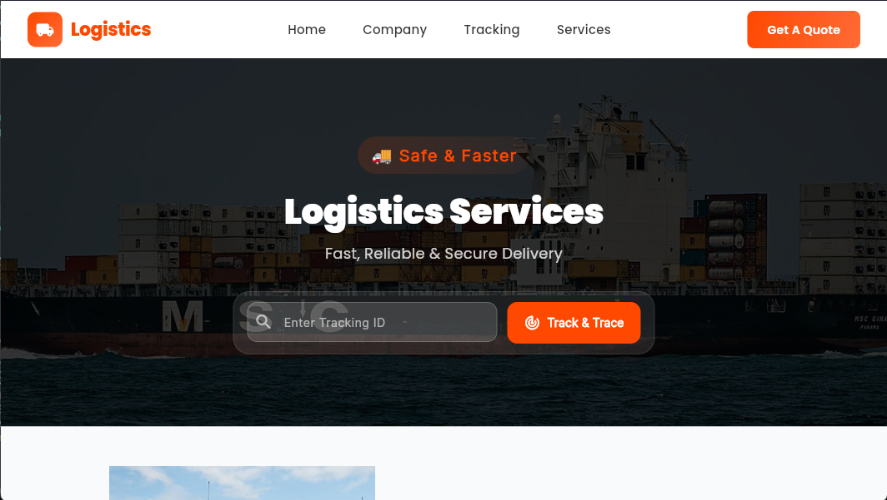

# Logistics Website 🚚

A responsive logistics and transportation website built with **Flutter Web** to provide customers with access to logistics services, delivery information, shipment tracking interfaces, and quotation requests.

## 📸 Screenshots

<!-- Add your screenshots to the screenshots/ folder in this repository -->


### Homepage


### Services


### Request a Quote


### Admion Dashboard


## 🌐 Live Demo

- **Website:** [View Live Website](YOUR_LIVE_WEBSITE_URL)
- **GitHub Repository:** [View Source Code](YOUR_GITHUB_REPOSITORY_URL)

*Replace these placeholders with your actual links.*

## ✨ Features

- Responsive design for desktop, tablet, and mobile screens.
- Modern homepage showcasing logistics services.
- Services section explaining available delivery and transportation solutions.
- Shipment tracking interface.
- Request-a-quote form for customer enquiries.
- Supabase integration for supported backend functionality.
- Reusable Flutter widgets and organized project structure.
- Navigation between website sections.
- Contact information and customer enquiry interface.

*Only retain features that are implemented and working in your project.*

## 🛠️ Technologies Used

- **Flutter Web** — User interface and responsive frontend.
- **Dart** — Application programming language.
- **Supabase** — Backend services and database integration.
- **Git and GitHub** — Version control and source code hosting.
- **GitHub Actions / GitHub Pages** — Automated build and website deployment, if configured.

## 🚀 Getting Started

### Prerequisites

Install the following tools before running the project:

- Flutter SDK
- Dart SDK (included with Flutter)
- Visual Studio Code or another compatible IDE
- Git
- A Supabase project, if required by the application

### Installation

1. Clone the repository:

   ```bash
   git clone YOUR_GITHUB_REPOSITORY_URL
   ```

2. Navigate to the project directory:

   ```bash
   cd YOUR_PROJECT_FOLDER
   ```

3. Install dependencies:

   ```bash
   flutter pub get
   ```

4. Configure the required Supabase settings using your project's environment or build-time configuration.

5. Run the application locally:

   ```bash
   flutter run -d chrome
   ```

### Build for production

```bash
flutter build web --release
```

The production files will be generated in the `build/web` directory.

## 🔐 Environment Configuration

Configure your Supabase project URL and publishable key according to the application's initialization code.

Never commit Supabase secret keys, service-role keys, passwords, or other private credentials to the repository.

Protect database operations with appropriate Row Level Security (RLS) policies.

## 📁 Project Structure

```text
lib/
├── main.dart
└── src/
    ├── features/
    │   ├── home/
    │   ├── services/
    │   ├── tracking/
    │   ├── quote/
    │   └── contact/
    ├── shared/
    └── core/

web/
assets/
test/
pubspec.yaml
README.md
```

*This is an illustrative structure. Adjust it to match your actual project folders.*

## 🗺️ Future Improvements

- Live shipment tracking integration.
- Customer accounts and shipment history.
- Quote request management dashboard.
- Email notifications for customer enquiries.
- Improved accessibility and performance.
- Additional automated tests.

## 👨‍💻 Developer

**Eddieton Osagie**

Industrial Engineering Graduate | Flutter Developer | Industrial Automation

Interested in building practical digital solutions for logistics, business operations, and industrial systems.

- GitHub: https://github.com/Eddtn/logistics_website.git


## 📄 License

This project is available for learning and portfolio demonstration. 

---

If you find this project useful, feel free to explore the repository and share feedback.
